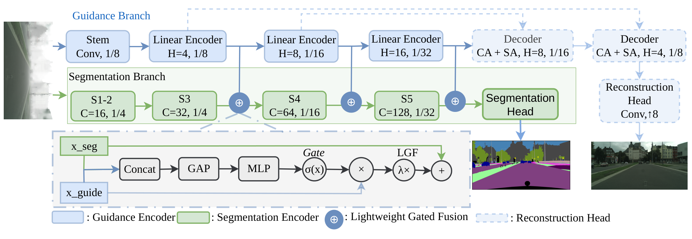

# LiDSeg

**Linear DehazeFormer Guidance for Efficient Semantic Segmentation in Adverse Weather Conditions**

BMVC 2026 · Yobsan Bayisa Leta, Christos Kyrkou, Maria K. Michael, Theocharis Theocharides · University of Cyprus

**Official benchmark model:** this repository contains the official LiDSeg PIDNet-L model
submitted to the [ACDC semantic segmentation benchmark](https://acdc.vision.ee.ethz.ch/submissions/6ac8c8bb3041fc0c1fd88257),
task *all* (fog, night, rain, snow).
The release includes the training, inference and submission code. Datasets, prediction archives
and checkpoint binaries are excluded from the Git repository.



## Overview

LiDSeg improves semantic segmentation under adverse weather using a lightweight guidance encoder supervised by auxiliary image reconstruction. At inference, the reconstruction decoder is removed, while the guidance encoder and Lightweight Gated Fusion (LGF) remain active. The design is plug-and-play, lightweight, and suitable for real-time edge deployment.

### Core components

- **Guidance encoder** (`models/dehazeformer.py`): gated linear attention at 1/8, 1/16, and 1/32 scales with 32/64/128 channels.
- **Reconstruction decoder** (`models/dehazeformer.py`): training-only Restormer-style decoder with PixelShuffle upsampling and residual reconstruction.
- **LGF** (`models/lgf.py`): channel-wise gated fusion at s8/s16/s32 with learnable per-stage scaling.
- **Losses** (`models/loss.py`): cross-entropy, Lovász-Softmax, auxiliary segmentation loss, Charbonnier reconstruction loss, and uncertainty weighting.
- **Wrapper** (`models/lidseg.py`): connects the backbone, guidance branch, and LGF. Set `guidance=False` for the unguided baseline.
- **Backbone** (`models/segmodels/pidnet.py`): PIDNet-L (37.31M), initialised from the official OpenMMLab Cityscapes weights.

This tree is rebuilt for **LiDSeg PIDNet-L** and runs in three steps: the Foggy Cityscapes fog
curriculum, ACDC fine-tuning, and the ACDC test-server submission. Other backbones will follow the
same curriculum and guidance; the previous multi-backbone code is in the git history.

## Installation

```bash
conda create -n lidseg python=3.12 -y
conda activate lidseg
pip install -r requirements.txt
cp configs/paths.env.example configs/paths.env   # then set the dataset roots
python tools/prepare_pidnetl_weights.py          # -> pretrained/PIDNet_L_Cityscapes_mmseg.pth
```

`prepare_pidnetl_weights.py` downloads the official OpenMMLab PIDNet-L Cityscapes checkpoint
(`...-0783ca6b.pth`, SHA-256 checked) and writes a weights-only copy. The mmseg file also pickles
mmengine log objects, which the trainer's safe `weights_only` loader rejects; the tool extracts the
tensors with a restricted unpickler so nothing from the download executes. The trainer then verifies
the output's pinned SHA-256 (`56f23bc4...`) before every run.

## Datasets

| Dataset | Use | Expected layout |
|---|---|---|
| Cityscapes + Foggy Cityscapes | Step 1 | `$CITYSCAPES_ROOT/{foggy_0.00,Foggy_0.005,Foggy_0.01,Foggy_0.02}/leftImg8bit/{train,val}`, `gtFine/{train,val}` (`*_labelTrainIds.png`); clear images under `$CITYSCAPES_CLEAR_ROOT/leftImg8bit` |
| ACDC | Steps 2-3 | `$ACDC_ROOT/rgb_anon/<condition>/{train,val,test,train_ref,val_ref}`, `gt/<condition>/{train,val}` (`*_gt_labelTrainIds.png`) |

Labels use Cityscapes `trainIds` (19 classes, `255` ignore). Obtain the datasets separately and
set their local roots in the ignored `configs/paths.env`. The `dataset/` directory in this
repository contains Python loaders and transforms.

## Step 1: Foggy Cityscapes

```bash
scripts/step1_foggy_cityscapes.sh            # GPUS=0,1,2,3 by default (exactly 4)
```

Config `configs/pidnetl_step1_foggy_cityscapes.yml`: stage 0 validates the pretrained model on clear
Cityscapes, then three training stages at fog density beta = 0.005 / 0.01 / 0.02 (200 / 100 / 100
epochs max, early-stop patience 10, LR x1.0 / 0.6 / 0.5) with 10 / 30 / 30 % replay of earlier fog
levels. Reconstruction is on: the decoder reconstructs the paired clear image (Charbonnier), with
uncertainty-weighted CE + 0.5 Lovasz + 0.4 aux segmentation loss. AdamW, base LR 1e-3, backbone at
0.01x, cosine schedule, AMP, 24 images per step (4 GPUs x 6). Validation is full resolution
(1024x2048) every epoch.

Output: `output/cityscapes/pidnetl_guided/` with `best_stage_N.pth` / `last_stage_N.pth` per stage,
`best.pth` = the dense-fog stage's best, `trainf.log`, and `eval_cs_foggy.json` (final and per-stage
checkpoints scored at clear and every fog density). Re-running the script resumes an interrupted
stage exactly; do not edit tracked source while a run is live.

## Step 2: ACDC

```bash
scripts/step2_acdc.sh                        # needs step 1 finished; GPUS=0,1 by default (exactly 2)
```

Config `configs/pidnetl_step2_acdc_uber_bblr0.1.yml`: fine-tunes the step-1 `best.pth` on all four
ACDC conditions (Uber). ACDC has no clear pairs, so the reconstruction decoder is dropped and only
the segmentation loss trains; the guidance encoder and LGF remain in the deployed model. AdamW, base
LR 4e-4 for guidance and LGF, **backbone at 0.1x (4e-5)**, 16 images per step (2 GPUs x 8), up to 100
epochs with patience 20, native-resolution (1080x1920) validation.

The backbone rate departs from the BiSeNetV2 paper setting (4e-4 on the whole network). On PIDNet-L,
whose backbone and heads hold 37.3M of the 39.6M parameters, that setting erased the step-1 model
within two epochs (val 44.7 -> 32.5, below the 34.0 the step-1 model scores on ACDC untrained).

Output: `output/acdc/pidnetl_norecon_uber_bblr0.1/` and `eval_acdc.json`, a single-checkpoint
per-condition val report. (`norecon` because the decoder is dropped on ACDC; `bblr0.1` names the
backbone rate. `evaluation/eval_acdc.py` reads `<backbone>_<variant>_<suffix>[_<tag>]`.)

## Step 3: ACDC test-server submission

```bash
scripts/step3_acdc_submission.sh             # needs step 2 finished; GPUS=0,1 by default
```

Predicts the 2000 ACDC test images with test-time augmentation (softmax averaged over scales
0.5 / 0.75 / 1 / 1.25 / 1.5 / 1.75 and horizontal flip, native resolution; `tools/acdc_tta.py`) and
writes to `output/acdc_submission/`:

- `lidseg_pidnetl_uber_tta_val_tta.json`: val score of exactly this inference setting;
- `lidseg_pidnetl_uber_tta.zip`: `labelTrainIds/<condition>/<sequence>/<frame>_labelTrainIds.png`,
  checked against the [submission rules](https://acdc.vision.ee.ethz.ch/submit) (one 1920x1080
  trainId PNG per test image, names start with the frame name, zip under 200 MB);
- `lidseg_pidnetl_uber_tta_model.pth`: weights-only model for the form's required *Model File*.

The official submitted model is the step-2 PIDNet-L checkpoint with guidance and LGF active,
without the reconstruction decoder, using the TTA setting above. The submitted weights-only
export has SHA-256 `62b6fc6c75f66884efb9cc01391ab21016018622def1c8598132bcd355d2c1c7`.

Submission form: Challenge *Semantic Segmentation*, Task *all*, Data used for training: *Labels* and
*External Data* (Cityscapes, Foggy Cityscapes, OpenMMLab Cityscapes-pretrained PIDNet-L); the ACDC
normal-condition images are not used. The server accepts one submission per 48 h, six per 30 days.

## Hand-off bundle for fault injection

```bash
GPU=0 scripts/make_fault_injection_bundle.sh   # needs step 2 finished
```

Builds a self-contained folder for collaborators who only run inference,
`output/handoff/lidseg_pidnetl_acdc/` (and a `.tar.gz` of it): the step-2 weights as one file, the
inference model code, the ACDC val split (images and trainId labels), `deploy/` (README for the
recipient, `run_eval.sh`, `setup_env.sh`, loader and evaluation), the golden-run report and a
per-module layer table. The build ends by running `bash run_eval.sh` inside the folder, which must
print PASS. The folder contains ACDC images: check the ACDC license before sending it to anyone.

## Notes on this rebuild

Fixed while preparing PIDNet-L (the original release had only been run on one GPU):

- DDP validation crashed: the padded eval-sampler index could not be unpickled in loader workers.
- DDP checkpointing crashed: gathering per-rank RNG state through `all_gather_object` failed on PyTorch 2.9.
- AMP: an fp16 gradient overflow raised in `clip_grad_norm_` instead of letting GradScaler skip the
  step, so any long run eventually crashed (single GPU too). Overflowed steps are now skipped; 20
  consecutive skips still fail loudly.
- DDP replicas diverged: the uncertainty-weighting parameters live in the criterion, outside DDP, so
  their gradients (and the shared clip norm) differed per rank. They are now averaged across ranks.
- DDP replay had shuffling off, so every rank replayed the same few clear images. Each rank now takes
  a disjoint shard of one shared per-epoch permutation.
- DDP validation mixed models: BatchNorm running statistics are rank-local, so ranks scored slightly
  different networks. Validation now broadcasts rank 0's buffers first; trainer val equals
  `eval_acdc.py` exactly.
- Inference leaked GPU memory: the backbone-output walk in `models/lidseg.py` was a recursive closure,
  a reference cycle that kept every call's logits alive until Python's cyclic GC ran (152 MB per
  1080x1920 prediction). Long evaluation loops ran out of memory; the walk is now iterative.

Clean PIDNet-L on Cityscapes val scores 79.88 in this pipeline (PIDNet-S: 77.70), about 1.0 below
the published mmseg numbers for both; the offset is pipeline-wide (not the port, not the labels), so
compare guided and unguided numbers within this pipeline.

## Results

Official benchmark submission: [ACDC benchmark board](https://acdc.vision.ee.ethz.ch/submissions/6ac8c8bb3041fc0c1fd88257).

Single checkpoint, full-resolution val, mIoU (%). These are validation results; the validation
split was used for checkpoint selection. They are not official benchmark test scores.

Step 1, Foggy Cityscapes (`best.pth` = dense-fog stage best; untrained PIDNet-L: dense 70.34):

| clear | beta 0.005 | beta 0.01 | beta 0.02 |
|---:|---:|---:|---:|
| 80.35 | 80.40 | 80.17 | 78.84 |

Step 2, ACDC val (406 images), and step 3's test-time augmentation on the same checkpoint:

| inference | fog | night | rain | snow | all (pooled) |
|---|---:|---:|---:|---:|---:|
| single scale | 79.54 | 55.26 | 75.47 | 79.19 | 74.49 |
| scales 0.5-1.75 + flip | 81.58 | 57.61 | 77.19 | 80.67 | 76.62 |

## Citation

```bibtex
@inproceedings{leta2026lidseg,
  title     = {LiDSeg: Linear DehazeFormer Guidance for Efficient Semantic
               Segmentation in Adverse Weather Conditions},
  author    = {Leta, Yobsan Bayisa and Kyrkou, Christos and
               Michael, Maria K. and Theocharides, Theocharis},
  booktitle = {British Machine Vision Conference (BMVC)},
  year      = {2026}
}
```

## License

LiDSeg is released under the MIT License. The vendored backbone ports in `models/segmodels/` and the dataloader base classes in `dataset/` retain their upstream licenses (MIT and Apache-2.0); each file header names its source, copyright holder, and license.

No datasets or pretrained weights are redistributed.

## Acknowledgements

This work has received funding from the European Union's Horizon Europe research and innovation programme under the Marie Skłodowska-Curie grant agreement No. 101169378 (TIRAMISU Doctoral Network), by the European Union's Horizon 2020 research and innovation programme under grant agreement No. 739551 (KIOS CoE), and from the Government of the Republic of Cyprus through the Cyprus Deputy Ministry of Research, Innovation and Digital Policy.

LiDSeg builds on [BiSeNetV2](https://github.com/CoinCheung/BiSeNet), [DDRNet](https://github.com/ydhongHIT/DDRNet), [STDC-Seg](https://github.com/MichaelFan01/STDC-Seg), [PIDNet](https://github.com/XuJiacong/PIDNet), [SCTNet](https://github.com/xzz777/SCTNet), [panoptic-deeplab](https://github.com/bowenc0221/panoptic-deeplab), [LovaszSoftmax](https://github.com/bermanmaxim/LovaszSoftmax), [DehazeFormer](https://github.com/IDKiro/DehazeFormer), [Restormer](https://github.com/swz30/Restormer), and [cityscapesScripts](https://github.com/mcordts/cityscapesScripts).
